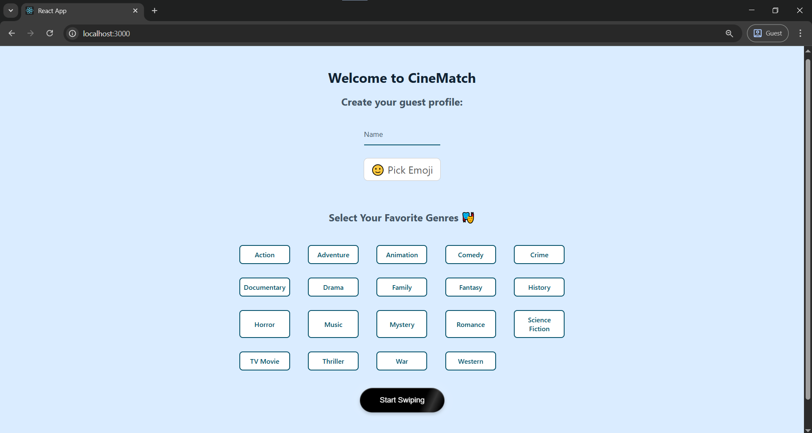
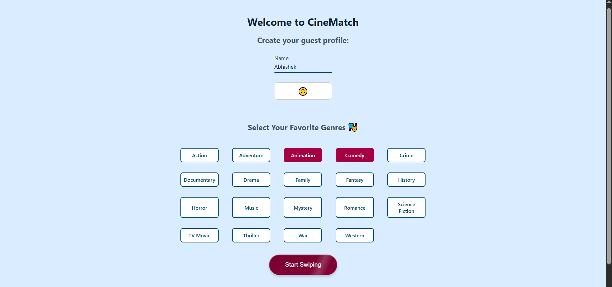
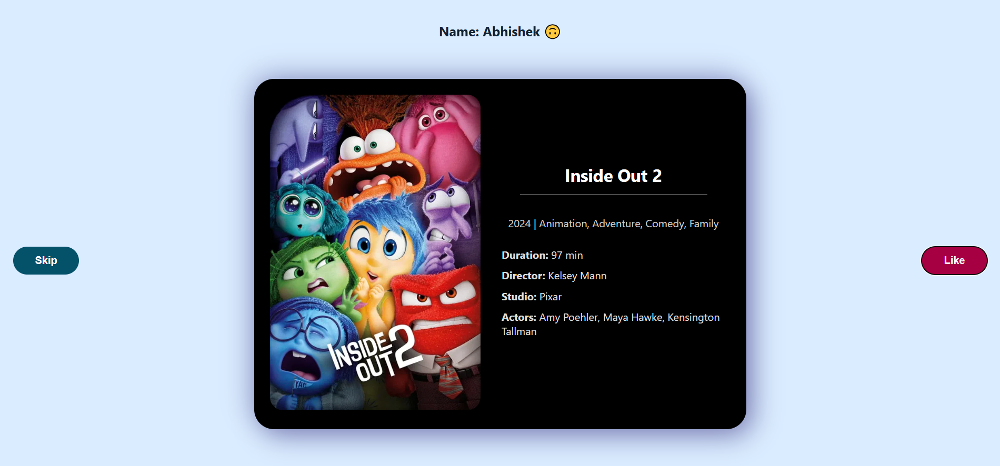
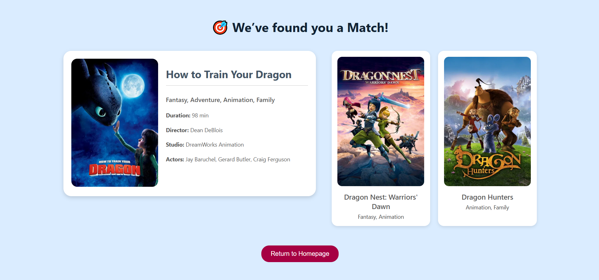

# CineMatch – Swiping-Based Movie Recommendation App

**CineMatch** is a swipe-based interactive web application that suggests movies based on user swipes (Like/Dislike). Users swipe on their favorite movies, and CineMatch provides individualized recommendations with the help of AI-driven similarity models and real-time movie data from TMDB.

## Screenshots
1. Login Page – Guest entry or user authentication

2. After Entering details in HERO section – Guest entry or user authentication

3. Swiping Screen – Swipe interface inspired by Tinder

4. Results Page – Top 3 movie suggestions after swiping


## Features

- **Swipe-Based Movie Selection**
    - Tinder-like interface where users swipe left/right on the posters of movies.
    - Saves user preferences in Firebase Firestore.

- **AI-Powered Recommendations**
    - Backend calculates movie similarities based on cosine similarity and TF-IDF vectorization.
    - Retrieves movie information dynamically from TMDB API.

- **User Authentication**
    - Guest mode with default user IDs for anonymous use.

- **Responsive UI**
    - Developed with React and Axios for quick frontend responses.
    - Results shown in real time after swiping.

## Tech Stack

- **Frontend:** React.js, Axios, HTML, CSS
- **Backend:** Python, Flask, Firebase Firestore
- **Machine Learning:** scikit-learn (Cosine Similarity, TF-IDF Vectorization)
- **API:** TMDB (The Movie Database) API

## Getting Started

1. Clone the repository
```bash
git clone https://github.com/your-username/CineMatch.git
cd CineMatch
```

2. Backend Setup (Terminal 1)
```bash
cd backend
python main.py
```

3. Frontend Setup (Terminal 2)
```bash
cd front-end
npx create-react-app .
npm install axios firebase
npm start
```
## Project Structure
```bash
CineMatch/
├── backend/
│   ├── firebase_config.py        # Firebase Admin SDK setup
│   ├── main.py                   # Flask app entrypoint with /recommend route
│   ├── recommendation.py         # Core recommendation logic (cosine similarity, TF-IDF)
│   ├── recommendation.ipynb      # Jupyter notebook for testing and exploration
│   ├── serviceAccountKey.json    # Firebase credentials (DO NOT commit to Git)
│   └── dataset/
│       └── vectorized_movies.pkl # Pickled vectorized movie dataset
│
├── front-end/
│   └── src/
│       ├── api/                   # API interaction layer
│       │   ├── axiosClient.js      # Axios base URL and interceptors
│       │   ├── recommend.js        # Fetch recommendations from Flask backend
│       │   └── tmdb.js             # TMDB API calls for movie details
│
│       ├── firebase/              # Firebase client-side config
│       │   └── firestoreUtils.js   # Firestore CRUD (save swipes, get likes)
│
│       ├── assets/                # Static assets (images, fonts, etc.)
│
│       ├── components/            # Reusable UI components
│       │   ├── GenreSelector.jsx    # Genre filters/dropdowns
│       │   ├── GenreSelector.css
│       │   ├── MovieCard.jsx        # Movie card component
│       │   ├── MovieCard.css
│
│       ├── pages/                 # Full route-level pages
│       │   ├── Login.tsx             # Login screen (with CSS)
│       │   ├── Login.css
│       │   ├── Swiper.jsx            # Movie swiping interface
│       │   ├── Swiper.css
│       │   ├── Results.jsx           # Final results (Top Picks layout)
│       │   ├── Results.css
│
├── screenshots/
└── README.md

```

## Setup Notes
- Ensure your TMDB API key and Firebase service account JSON are properly set up.
- Both backend (Flask) and frontend (React) should be running at the same time for proper functionality.

## Future Improvements
- Implement Google/Firebase Auth login
- Group movie swiping sessions support
- Publish on Render/Netlify for live demo access

Coded by Abhishek Karthik